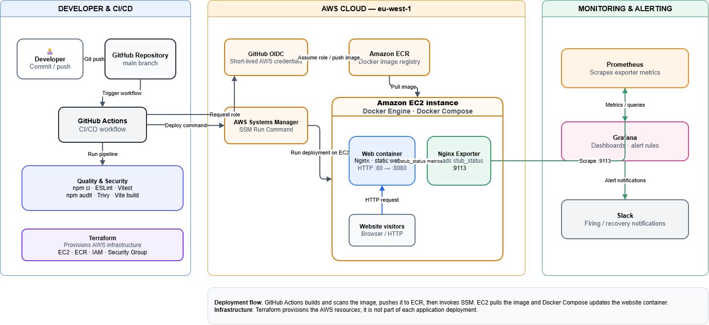

# DeploySteps

### From Code to Production — Automated with DevOps

DeploySteps is a practical DevOps project developed for the Postgraduate Diploma in Computing (DevOps). It demonstrates how a web application can be built, tested, security-scanned, containerised, deployed to AWS and monitored through an automated CI/CD pipeline.

## Technology Stack

| Area | Technologies |
|---|---|
| Source control and CI/CD | Git, GitHub, GitHub Actions |
| Application and testing | JavaScript, Vite, Vitest, ESLint |
| Security scanning | npm audit, Trivy |
| Containers | Docker, Docker Compose |
| AWS and deployment | EC2, ECR, IAM, GitHub OIDC, Systems Manager (SSM) |
| Infrastructure as Code | Terraform |
| Web server and monitoring | Nginx, Prometheus, Grafana, Nginx Prometheus Exporter |

## Architecture



The diagram shows the application delivery path from GitHub Actions to Amazon ECR and EC2. The website, Nginx Exporter, Prometheus and Grafana run as Docker Compose services on the EC2 instance; Grafana sends alert notifications to Slack. Terraform provisions the AWS infrastructure.

## CI/CD Pipeline

The workflow is defined in `.github/workflows/ci.yml` and automates these stages:

1. **Source code management:** Git and GitHub provide version control, feature branches, pull requests and commit history. [Project repository](https://github.com/L00205909/DeploySteps)
2. **Build and testing:** GitHub Actions installs dependencies with `npm ci`, runs ESLint and Vitest, and builds the application with Vite.
3. **Code quality and security:** ESLint checks code quality, `npm audit` checks dependencies, and Trivy scans the Docker image. The Trivy check fails the pipeline when HIGH or CRITICAL vulnerabilities are detected.
4. **Containerisation:** A multi-stage Dockerfile builds the application image. The runtime uses an unprivileged Nginx container, while Docker Compose manages the application and monitoring services.
5. **Cloud deployment:** The image is pushed to Amazon ECR. GitHub Actions authenticates to AWS using OIDC and sends deployment commands through Systems Manager. EC2 pulls the image and Docker Compose updates the running application. No public SSH access is required.
6. **Monitoring and alerting:** Prometheus collects Nginx metrics through the Nginx Prometheus Exporter. Grafana displays metrics such as active connections and HTTP request activity, and sends alerts to the `#deploysteps-alerts` Slack channel.

### Configured Grafana alerts

| Alert | Condition | Severity |
|---|---|---|
| `DeploySteps-NginxExporterDown-Test` | Nginx exporter is unavailable | Critical |
| `DeploySteps-WebsiteDown` | `nginx_up` is below 1 | Critical |
| `DeploySteps-HighConnections` | Active Nginx connections exceed 100 for 2 minutes | Warning |

The website and exporter alerts were tested by stopping the relevant services. Slack firing and recovery notifications were confirmed. The HighConnections alert is configured but was not manually tested.

Container logs can be inspected with `docker compose logs` locally. Grafana and Prometheus are not publicly exposed; Grafana administration is accessed through SSM port forwarding.

## AWS Infrastructure and Security

Terraform provisions and manages the EC2 instance, ECR repository, IAM roles and policies, instance profile, security group and ECR lifecycle policy in AWS region `eu-west-1`.

Security measures include:

- GitHub OIDC authentication instead of long-lived AWS access keys.
- Scoped ECR permissions for the GitHub Actions role.
- An IAM instance profile for EC2 and Systems Manager for instance access and deployment.
- No public SSH access; the security group allows HTTP traffic on port 80.
- Grafana and Prometheus are restricted to localhost on the EC2 instance.
- Trivy image scanning and an unprivileged Nginx runtime container.

## Run Locally

**Prerequisites:** Git, Node.js and npm, and Docker Desktop with Docker Compose.

```bash
git clone https://github.com/L00205909/DeploySteps.git
cd DeploySteps
npm ci
npm run dev
```

Run tests and build:

```bash
npm test
npm run lint
npm run build
```

Run with Docker Compose:

```bash
docker compose up --build -d
docker compose ps
docker compose logs
docker compose down
```

Demo Verification